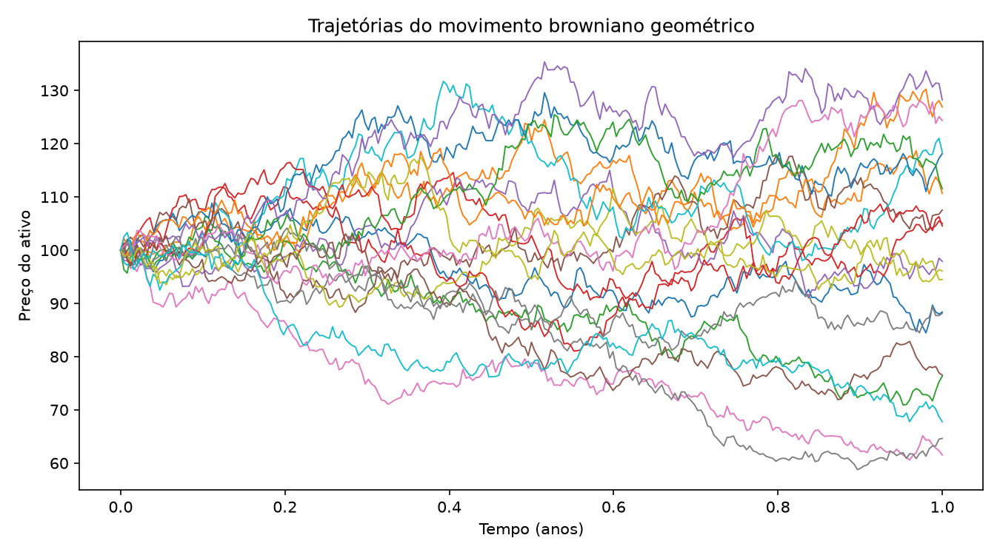
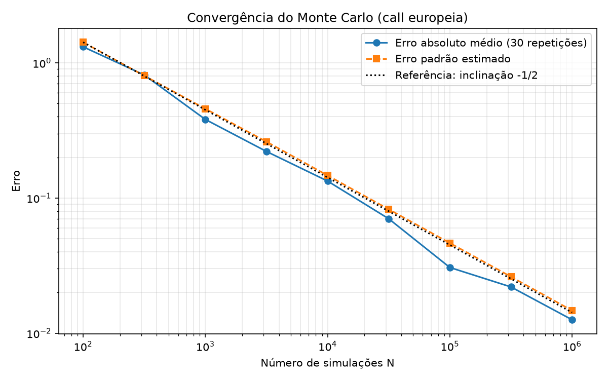
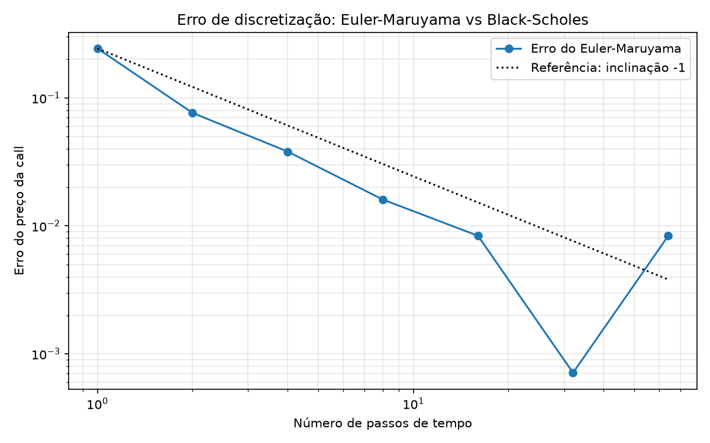

English | [Português](README_pt.md)

# monte-carlo-option-pricing

Monte Carlo pricing of European options, validated against the Black-Scholes analytical solution. A personal project built from the Stochastic Processes course (ENSEEIHT, MF2E), focused on numerical rigor: validation against an exact solution, convergence analysis, and a clear separation between statistical error and discretization error.

## What the project does

- Simulates geometric Brownian motion (GBM), using both the exact solution and the Euler-Maruyama scheme
- Prices a European call by Monte Carlo and compares it with the Black-Scholes formula
- Measures the convergence of the Monte Carlo error (1/sqrt(N) rate)
- Measures the Euler-Maruyama discretization error, separately from statistical noise
- Applies antithetic variates as a variance reduction technique
- Automated tests with pytest
- Prices an arithmetic-average Asian call, which has no closed-form solution

## Results

Parameters in all experiments: S0 = 100, K = 100, r = 5%, sigma = 20%, T = 1 year. Analytical call value (Black-Scholes): **10.4506**.

### Simulated paths



Twenty GBM paths. The dispersion grows with time, as expected from a Wiener process.

### Monte Carlo vs Black-Scholes

| N | Monte Carlo | Standard error | Absolute error |
|---|---|---|---|
| 100 | 7.8258 | 1.0120 | 2.6248 |
| 1,000 | 9.9120 | 0.4483 | 0.5386 |
| 10,000 | 10.3452 | 0.1477 | 0.1054 |
| 100,000 | 10.4205 | 0.0468 | 0.0300 |
| 1,000,000 | 10.4532 | 0.0147 | 0.0026 |

### Monte Carlo convergence



On a log-log scale, the standard error follows the reference line of slope -1/2, a consequence of the central limit theorem: reducing the error by a factor of 10 requires 100 times more simulations. The mean absolute error (30 repetitions per N) follows the same slope, with residual noise because it is an average over a small number of repetitions.

### Euler-Maruyama discretization error



Call price error using Euler-Maruyama with 1 million paths and the same seed in every case:

| Steps | Price | Error |
|---|---|---|
| 1 | 10.2070 | 0.2436 |
| 2 | 10.3743 | 0.0763 |
| 4 | 10.4125 | 0.0381 |
| 8 | 10.4345 | 0.0160 |
| 16 | 10.4590 | 0.0084 |
| 32 | 10.4513 | 0.0007 |
| 64 | 10.4589 | 0.0083 |

Between 2 and 16 steps, the error decreases consistently with weak order 1, as expected for Euler-Maruyama. From about 16 steps onward, the discretization error falls below the Monte Carlo noise (standard error of roughly 0.015 with N = 10^6), and the curve is no longer informative: the values at 32 and 64 steps reflect statistical fluctuation, not the behavior of the method. Verifying the order more sharply would require a larger N or the same Brownian increments across refinement levels.

### Variance reduction with antithetic variates

Using (Z, -Z) pairs, the standard error drops consistently for the same number of draws:

| N | Plain standard error | Antithetic standard error | Reduction |
|---|---|---|---|
| 1,000 | 0.4462 | 0.3074 | 1.45x |
| 10,000 | 0.1460 | 0.1050 | 1.39x |
| 100,000 | 0.0464 | 0.0328 | 1.41x |
| 1,000,000 | 0.0147 | 0.0104 | 1.41x |

The reduction is about 1.4x in standard error, equivalent to needing roughly half the simulations for the same precision. The technique improves the error constant, not the 1/sqrt(N) rate.

## How to run

```
python -m venv .venv
.venv\Scripts\activate
pip install -r requirements.txt
python -m scripts.compare_prices
python -m scripts.plot_paths
python -m scripts.plot_convergence
python -m scripts.plot_euler
python -m scripts.compare_variance_reduction
python -m pytest
```

The commands above are for Windows. On Linux or macOS, activate the environment with `source .venv/bin/activate`.


### Call asiática (sem fórmula fechada)

Uma call asiática de média aritmética paga max(preço médio ao longo do ano - K, 0). Não existe preço fechado simples, então o Monte Carlo é necessário. Com 200.000 trajetórias e 252 passos diários:

| Opção | Preço | Erro padrão |
|---|---|---|
| Call europeia (Black-Scholes) | 10,4506 | - |
| Call asiática (Monte Carlo) | 5,7680 | 0,0179 |

O preço da asiática é cerca de 55% do da europeia, como esperado: a média suaviza a trajetória e reduz a chance de um ganho grande. Este resultado não foi validado contra um valor exato; uma verificação natural seria a asiática de média geométrica, que tem preço fechado.
## Structure

```
src/
  gbm.py        GBM simulation (exact solution and Euler-Maruyama)
  pricing.py    Monte Carlo, antithetic variates and Black-Scholes
scripts/        experiments and plot generation
tests/          automated tests
```

## Theory summary

Under the risk-neutral measure, the asset price follows

dS = r S dt + sigma S dW,

where W is a Wiener process. The exact solution is

S_T = S0 exp((r - sigma^2 / 2) T + sigma sqrt(T) Z), with Z ~ N(0, 1).

The -sigma^2/2 term is the correction coming from Ito's lemma. The price of a European call is the discounted expected payoff:

C = exp(-rT) E[max(S_T - K, 0)].

Monte Carlo estimates this expectation with a sample mean over N draws, with standard error s / sqrt(N), where s is the sample standard deviation of the discounted payoffs. For the European case a closed-form Black-Scholes formula exists and is used here as the validation reference. The normal cumulative distribution function is computed with `math.erf`, with no SciPy dependency.

The Euler-Maruyama scheme approximates the SDE step by step:

S[k+1] = S[k] + r S[k] dt + sigma S[k] sqrt(dt) Z[k].

It introduces a discretization error that depends on the step size dt, distinct from the statistical error of Monte Carlo, which depends on N.

## Limitations

- European call only, with constant parameters (no stochastic volatility or dividends)
- Verification of the Euler-Maruyama order is limited by Monte Carlo noise beyond 16 steps
- `requirements.txt` still lists SciPy, but no module in the project imports it

## License

MIT
